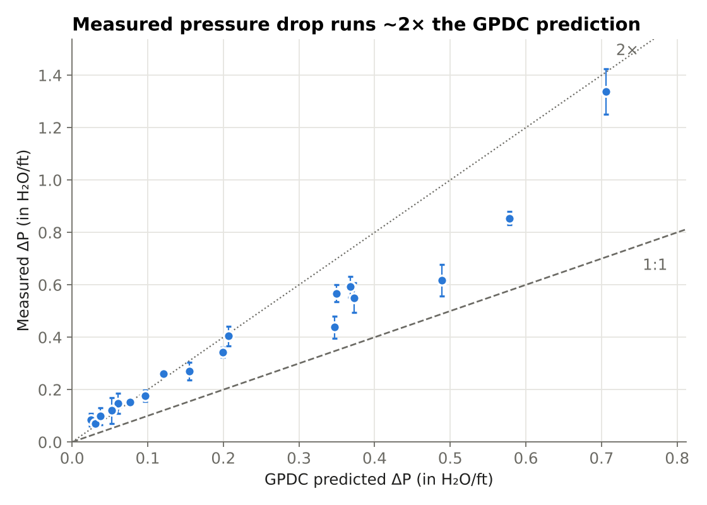
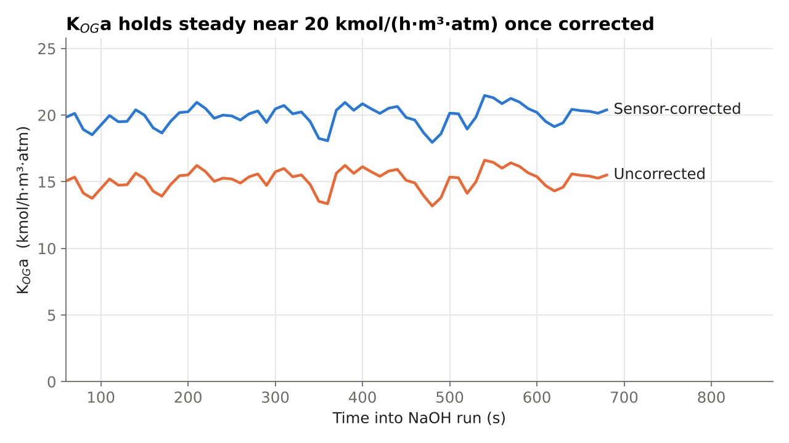
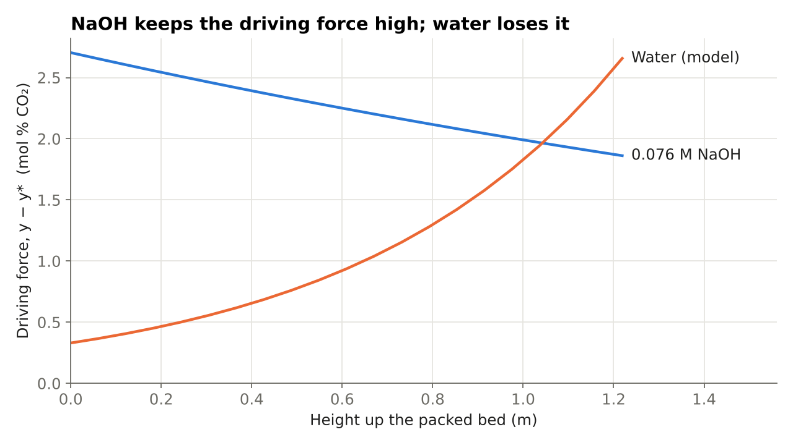

# Packed-Column CO₂ Absorption

Analysis of a pilot packed column that absorbs CO₂ from air into dilute NaOH and into water. The project covers the column's hydraulics, its mass-transfer coefficient and how the NaOH concentration changes the result. All of the analysis is in one Python script. It reads the raw lab workbooks and writes every computed number to `results.json`, plus a self-contained findings page (`index.html`) with interactive charts.

**[View the findings page →](https://elmho011.github.io/co2-packed-column-absorption/)**

## Objectives

1. Compare the measured gas-phase pressure drop with the Strigle generalized pressure-drop correlation (GPDC).
2. Determine the overall gas-phase coefficient **K<sub>OG</sub>a** for CO₂ absorbing into dilute NaOH.
3. Show how NaOH concentration affects the absorption driving force, compared with water.

## Key results

**In short:** the NaOH solution removed about **31% of the CO₂** from the air. That's roughly **18 times more** than plain water would remove under the same conditions. The column's pressure drop came out about **2× higher** than the standard design chart predicts.

### 1. Pressure drop is about 2× the chart prediction
- Across 18 gas and liquid flow combinations, the measured pressure drop was **1.3–3.3× higher** than the generalized pressure-drop correlation (GPDC), with a typical value of 1.9×.
- The likely reason is that the column's small ½-in packing falls outside the range the chart was built for, so the prediction is an extrapolation.
- The column is predicted to flood at about **16.5 SCFM of gas** at the lowest liquid rate (0.5 GPM). That limit falls to **11 SCFM** at 1.5 GPM.



### 2. CO₂ transfers at K<sub>OG</sub>a ≈ 20 kmol/(h·m³·atm)
- K<sub>OG</sub>a measures how quickly CO₂ moves from the gas into the liquid per unit of column volume. A higher value means a shorter column can do the same job.
- The outlet CO₂ sensor read slightly high. Correcting for it raised the result from **15 → 20**, with an uncertainty of ±1.2 from a 4,000-trial Monte Carlo simulation.
- **Literature check:** Perry's Handbook gives about 12 once its value is adjusted to this experiment's weaker NaOH. The measured value is higher, which makes sense because the smaller packing has more surface area for contact.



### 3. NaOH absorbs far more than water
- With NaOH, **31%** of the CO₂ was removed. For water at the same flows, the model predicts only **~2%**.
- **Why:** NaOH reacts with CO₂ as soon as it dissolves, so the liquid never fills up and keeps absorbing all the way down the column. Water saturates almost right away and then stops absorbing.



<details>
<summary>Detailed numbers</summary>

| Result | Value |
|---|---|
| K<sub>OG</sub>a, sensor-corrected | 19.9 ± 1.2 kmol/(h·m³·atm) |
| K<sub>OG</sub>a, uncorrected | 15.2 ± 0.8 kmol/(h·m³·atm) |
| CO₂ removal, NaOH / water (7.5 SCFM, 1.35 GPM) | 31% / ~2% |
| Measured ΔP ÷ GPDC prediction | 1.3–3.3× (median 1.9×, n = 18) |
| Flooding gas rate (0.5 → 1.5 GPM liquid) | 16.5 → 11.0 SCFM |
| Analyzer calibration | out = 0.047 + 1.068 × in (n = 27) |
| Hatta number / effective interfacial area | 8.8 / 184 m²/m³ (~30% of dry packing area) |
| Perry's value scaled to 0.061 M [OH⁻] | ~12 kmol/(h·m³·atm) |

</details>

## Equipment and conditions

| Item | Value |
|---|---|
| Column inside diameter | 4 in |
| Packed height | 48 in (1.22 m) |
| Packing | ½-in ceramic Intalox saddles (F<sub>p</sub> = 200 ft⁻¹) |
| NaOH concentration | 0.076 M (HCl titration) |
| Absorption run | 7.5 SCFM gas, 1.35 GPM liquid, ~22 °C, 1 atm |
| Run dates | Sept. 17 – Oct. 15, 2026 |

## Repository contents

| File | What it is |
|---|---|
| `gas_absorption_project.py` | The full analysis: data loading, hydraulics, calibration, K<sub>OG</sub>a, kinetics and the page builder |
| `results.json` | Every computed number, written by the script |
| `index.html` | The findings page, generated by the script (charts, tables, literature comparison) |
| `make_figures.py` | Draws the README charts in `figures/` from `results.json` |
| `requirements.txt` | Python dependencies |

## How to run

The raw data workbooks are not included in this repo. To reproduce the results, place these two files in a folder:

- `Gas Absorption Data.xlsx`: the lab workbook (Summary sheet, one sheet per run, GPDC Comparison)
- `GPDC-1.xlsx`: the digitized Strigle GPDC curves

Then run:

```bash
pip install -r requirements.txt
python gas_absorption_project.py --data-dir "path/to/data" --out-dir .
```

The script prints a summary to the console and rewrites `results.json` and `index.html`.

## Assumptions and limitations

- The lab temperature is assumed to be 22 °C, and water properties are used for the dilute NaOH solution.
- Only data from the steady-state window (60–680 s after liquid flow starts) is used.
- The GPDC prediction is extrapolated, because F<sub>p</sub> = 200 ft⁻¹ is outside the chart's published range.
- The water case is a model prediction: the analyzers can't resolve a ~2% change in CO₂.
- The reaction rate constant (Pohorecki & Moniuk) and Henry's constant are literature values, not measured ones.

## References

- Perry's Chemical Engineers' Handbook, Ch. 14: Gas Absorption and Gas–Liquid System Design
- Kister, H. Z., Scherffius, J., Afshar, K., Abkar, E. (2007). Realistic prediction of flooding and pressure drop in packed columns
- Strigle, R. F. *Packed Tower Design and Applications*: the generalized pressure-drop correlation
- Pohorecki, R., Moniuk, W. (1988). Kinetics of reaction between carbon dioxide and hydroxyl ions in aqueous electrolyte solutions

## Author

Yaseen Fouad, Chemical Engineering, Rutgers University
Process Engineering Laboratory I, Fall 2026

Lab data collected with Jess Lejuez and Ryan Steinhart.
